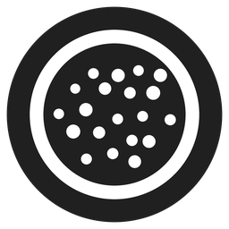
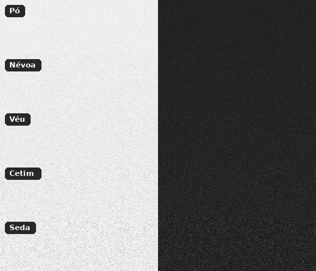

<p align="center"></p>

<h1 align="center">Eye Sight</h1>

<p align="center">Textura de papel (grain) sobre a tela do Windows, para ler com mais conforto.<br>
Fica só na bandeja, como o Twinkle Tray: sem janela na barra de tarefas, sem aparecer no Alt+Tab.</p>

---

Inspirado no "Modo de leitura → Textura" dos celulares Poco/Xiaomi: uma camada de grão bem fino sobre a tela que quebra o brilho "plástico" do monitor e deixa a leitura parecida com papel. O Eye Sight só mexe na textura (não altera cor nem temperatura).

- **Só na bandeja.** Um clique no ícone abre um painel com o slider de intensidade e os estilos.
- **Invisível para o resto do sistema.** Não aparece na barra de tarefas, no Alt+Tab nem no Win+Tab, e cliques passam direto pela textura.
- **Cinco estilos finos**, do mais fino ao mais marcado.
- **Inicia com o Windows** direto na bandeja e lembra a última configuração.
- **Leve.** Um .exe de ~100 KB em C/Win32 puro, sem dependências. A textura é estática e composta pelo próprio Windows (DWM), então o custo de CPU/GPU é praticamente zero.
- Multi-monitor, DPI por monitor, tema claro/escuro e cor de destaque do Windows.

## Estilos

| | Estilo | Descrição |
|---|---|---|
| 1 | **Pó** | O mais fino de todos, quase imperceptível |
| 2 | **Névoa** | Finíssimo e suave |
| 3 | **Véu** | Muito fino, sem aglomerados |
| 4 | **Cetim** | Fino e uniforme |
| 5 | **Seda** (padrão) | O mais marcado, ótimo para ler por horas |

<p align="center"></p>

Todos usam grão de 1 pixel físico. Os quatro mais finos usam ruído filtrado ("ruído azul", sem aglomerados), que o olho percebe como mais miúdo.

## Instalação

Baixe na página de [Releases](../../releases):

- **`EyeSight.exe`**: versão portátil. Coloque numa pasta fixa e abra com dois cliques. A textura cobre tudo, menos o menu Iniciar, a busca e a barra de tarefas.
- **`EyeSight-Instalador.zip`**: versão completa, em que a textura cobre também o menu Iniciar e a barra. Extraia e rode `Instalar.cmd` (pede administrador). Para remover, use `Desinstalar.cmd`.

Na primeira execução o SmartScreen pode avisar que o app não é reconhecido, porque o .exe não é assinado por uma autoridade comercial. Clique em **Mais informações → Executar assim mesmo**.

Requer Windows 10 ou 11 (64 bits). No Windows 11 o painel tem cantos arredondados e fundo acrílico.

## Uso

- **Clique** no ícone da bandeja: abre o painel. Se o ícone estiver escondido, arraste-o da setinha `^` para a barra.
- **Slider**: intensidade. Também funciona com a roda do mouse, as setas, Page Up/Down e Home/End.
- **Amostras** abaixo do slider (ou teclas **1** a **5**): troca o estilo.
- **Botão de energia** (ou **Espaço**): liga/desliga lembrando a intensidade.
- **Engrenagem** ou **clique direito** no ícone: menu com *Estilo da textura*, *Iniciar com o Windows*, *Esconder a textura em prints* e *Sair*.
- **Esc** ou clicar fora: fecha o painel.

Configurações ficam em `HKCU\Software\EyeSight`; a inicialização automática, em `HKCU\Software\Microsoft\Windows\CurrentVersion\Run`.

## Como funciona

Cada monitor recebe uma janela com:

- `WS_EX_TOOLWINDOW`: fica fora da barra de tarefas, do Alt+Tab e do Win+Tab;
- `WS_EX_LAYERED` com alpha por pixel: o DWM mistura a textura com a tela; o slider muda só o alpha global (`UpdateLayeredWindow`), então arrastar é instantâneo;
- `WS_EX_TRANSPARENT` + `WS_EX_NOACTIVATE`: cliques e teclado atravessam, nunca recebe foco;
- a propriedade `NonRudeHWND` e 1 px a menos de altura, para o Explorer não tratá-la como app em tela cheia (senão a barra de tarefas com ocultação automática deixa de subir);
- `SetWindowDisplayAffinity(WDA_EXCLUDEFROMCAPTURE)` (opcional), para a textura não sair em prints e gravações.

O menu Iniciar e a barra de tarefas ficam numa faixa de z-order acima de qualquer janela "sempre no topo". Só processos com `uiAccess="true"` (assinados por um certificado confiável e instalados em uma pasta protegida, como Arquivos de Programas) podem criar janelas na faixa `ZBID_UIACCESS`, acima deles. É isso que o instalador faz:

1. copia `EyeSight-uiaccess.exe` (manifesto com `uiAccess="true"`) para `C:\Program Files\Eye Sight\EyeSight.exe`;
2. cria um certificado autoassinado *Eye Sight (assinatura local)*, exclusivo daquele computador, e o adiciona como confiável;
3. assina o .exe e **apaga a chave privada** logo em seguida, para que o certificado não possa assinar mais nada.

`Desinstalar.cmd` remove o programa, o certificado e a inicialização automática.

## Compilar

Não há dependências além do compilador.

**Linux/macOS** (mingw-w64):

```sh
sudo apt install gcc-mingw-w64-x86-64   # Debian/Ubuntu
sh build.sh
```

**Windows** ([MSYS2](https://www.msys2.org/) com MinGW-w64, `gcc` e `windres` no PATH):

```bat
build.bat
```

A saída fica em `build/`. O GitHub Actions compila a cada push. Para publicar uma release, crie uma tag `v*` ou rode o workflow **Build** manualmente (aba Actions → Run workflow) informando a versão.

### Estrutura

```
src/
  main.c            bandeja, painel, camadas da textura
  grain.h           geração das texturas e lista de estilos
  app*.rc, *.manifest, app.ico
installer/          Instalar.cmd / install.ps1, Desinstalar.cmd / uninstall.ps1
tools/
  preview.c         gera prévia dos estilos (PPM) sem precisar do Windows
  make_icon.py      gera src/app.ico a partir dos pontos do ícone em main.c
```

Para criar um estilo novo, adicione uma linha em `PRESETS` em `src/grain.h`. O painel se ajusta sozinho ao número de estilos, e o resultado pode ser conferido com `tools/preview.c`.

## Licença

[MIT](LICENSE)
